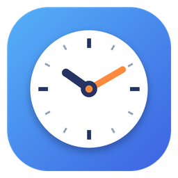
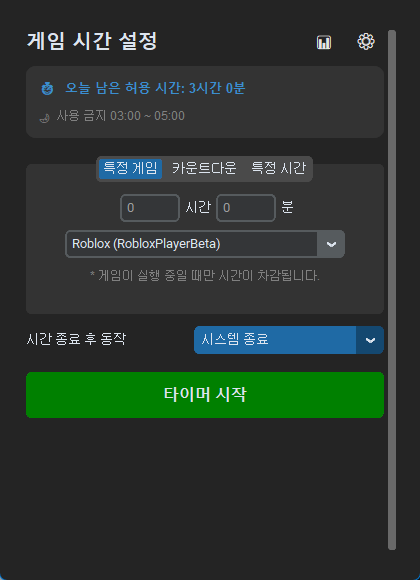
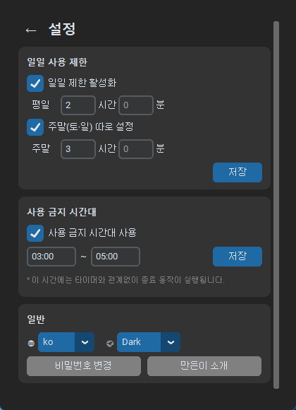

<p align="center">
  
</p>

# 타임페어런츠 (TimeParents) v1.11.2

자녀의 PC·게임 사용 시간을 관리하는 Windows용 자녀 보호 프로그램입니다.

<p align="center">
  
  &nbsp;
  
</p>

## 📥 다운로드

**[최신 버전 다운로드 (GitHub Releases)](https://github.com/EricSeokgon/TimeParents/releases/latest)**

zip 파일을 받아 압축을 풀고 `TimeParents.exe`를 실행하면 됩니다. Python을 설치할 필요는 없습니다.

## Windows 계정 하나로 가족 프로필 사용하기

가족이 같은 Windows 계정으로 로그인해도 아이마다 TimeParents 이름과 PIN을 만들 수 있습니다. 부모는 아이별 하루 한도를 한 번 정해 두고, 아이는 컴퓨터를 쓸 때마다 남은 한도 안에서 이번에 쓸 시간을 직접 고릅니다.

### 처음 한 번, 부모가 설정하기

1. TimeParents.exe를 실행하고 **가족 프로필 · Windows 계정 하나로 사용**을 누른 뒤 TimeParents 부모 비밀번호를 입력합니다. 처음 설치했다면 첫 실행 화면에서 부모 비밀번호를 정합니다.
2. **새 자녀**에서 이름, 숫자 PIN 4~12자리, 평일·주말 하루 한도(분)를 입력하고 **프로필 저장**을 누릅니다. 다른 아이도 같은 방법으로 등록합니다.
3. **공유 로그인 시작**을 누릅니다. 이제 같은 Windows 계정에 로그인하면 TimeParents가 자동으로 열리고 가족을 선택하는 화면이 나타납니다.

### 아이가 사용하고 부모가 기록 확인하기

- 아이는 자기 이름과 PIN으로 로그인하고 30분, 1시간, 1시간 5분, 1시간 30분 또는 직접 입력한 시간을 선택합니다. 30분을 선택하고 12분 뒤 **사용 끝내기**를 누르면 12분만 차감되고, 같은 날 다시 로그인하면 남은 18분을 이어 쓸 수 있습니다. 시간이 다 되면 가족 선택 화면으로 돌아갑니다.
- 부모는 **부모 로그인 → 가족 프로필 및 사용 기록**에서 아이를 선택해 최근 90일의 앱 로그인 시각, 사용 시작·종료 시각, 선택한 시간과 실제 사용 시간을 확인합니다. 같은 화면에서 **오늘만 10분 추가**와 가족 공통 금지 시간도 설정할 수 있습니다.
- 기록은 로그인에 사용한 프로필에 남습니다. 부모가 자리를 비울 때는 **사용자 전환**을 누르거나 **Win+L**로 Windows를 잠그세요. 공유 계정에서 앱이 꺼져 있는 동안의 사용은 기록되지 않습니다.

## ✨ 주요 기능

- **가족 프로필**을 켜면 Windows 계정 하나를 함께 쓰면서 아이마다 이름과 PIN으로 로그인할 수 있습니다. 아이는 남은 한도 안에서 이번 사용 시간을 선택하고, 부모는 자녀별 기록을 확인합니다. [가족 프로필 설정](TimeParents/shared-profiles.md)
- 자녀별 Windows 계정을 이미 사용한다면 기존 고급 모드도 사용할 수 있습니다. [설치 및 복구](TimeParents/family/README.md)

- **3가지 타이머 모드**: 카운트다운, 특정 시각에 종료, 특정 게임이 켜져 있을 때만 시간 차감
- **일일 사용 제한**: 하루 총 사용 시간 제한, 주말(토·일)은 따로 설정 가능
- **사용 금지 시간대**: 예) 21:00 ~ 07:00. 타이머를 켜지 않아도 적용되고 10·5·1분 전에 미리 경고
- **시간 종료 후 동작**: 시스템 종료, 로그오프, 화면 잠금, 게임만 종료 (모두 60초 유예 후 실행)
- **우회 방지**: 비밀번호 없이는 중지·종료·설정 변경 불가, 작업 관리자로 강제 종료해도 다시 켜지면 타이머 복원
- **사용 통계**: 일일·주간 사용 기록 확인
- 다크/라이트 테마, 한국어/English 지원

자세한 기능 설명, 비밀번호 재설정 방법, 버전 기록은 **[TimeParents/README.md](TimeParents/README.md)** 에 있습니다.

## 🚀 소스에서 실행하기

```bash
cd TimeParents
pip install -r requirements.txt
python main.py
```

실행 파일 빌드와 테스트:

```bash
cd TimeParents
pyinstaller --noconfirm TimeParents.spec
python -m unittest discover -s tests
```

## 📁 저장소 구성

| 폴더 | 내용 |
| --- | --- |
| [`TimeParents/`](TimeParents) | 타임페어런츠 프로그램 (Python, CustomTkinter) |
| [`ChromeBookmarkManager/`](ChromeBookmarkManager) | Chrome 북마크 관리 확장 프로그램 |

## 📝 라이선스

개인 및 교육 목적으로 자유롭게 사용할 수 있습니다.

## 🤝 기여

버그 제보나 기능 제안은 언제든지 환영합니다! ([Issues](https://github.com/EricSeokgon/TimeParents/issues), leesk55@gmail.com)

---

**TimeParents** - 자녀의 건강한 PC 사용 습관을 위한 선택
