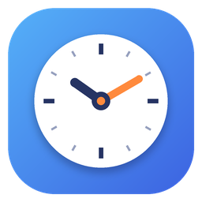
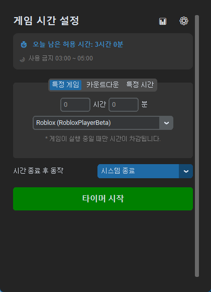
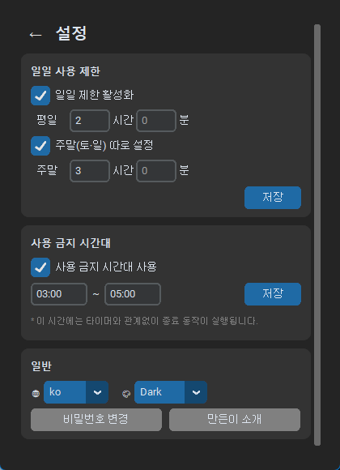

<p align="center">
  
</p>

# 타임페어런츠 (TimeParents) v1.9.0

자녀의 PC·게임 사용 시간을 관리하는 Windows용 자녀 보호 프로그램입니다.

<p align="center">
  
  &nbsp;
  
</p>

## 📥 다운로드

**[최신 버전 다운로드 (GitHub Releases)](https://github.com/EricSeokgon/TimeParents/releases/latest)**

zip 파일을 받아 압축을 풀고 `TimeParents.exe`를 실행하면 됩니다. Python을 설치할 필요는 없습니다.

## ✨ 주요 기능

- **3가지 타이머 모드**: 카운트다운, 특정 시각에 종료, 특정 게임이 켜져 있을 때만 시간 차감
- **일일 사용 제한**: 하루 총 사용 시간 제한, 주말(토·일)은 따로 설정 가능
- **사용 금지 시간대**: 예) 21:00 ~ 07:00. 타이머를 켜지 않아도 적용되고 10·5·1분 전에 미리 경고
- **시간 종료 후 동작**: 시스템 종료, 로그오프, 화면 잠금, 게임만 종료 (모두 60초 유예 후 실행)
- **우회 방지**: 비밀번호 없이는 중지·종료·설정 변경 불가, 작업 관리자로 강제 종료해도 다시 켜지면 타이머 복원
- **사용 통계**: 일일·주간 사용 기록 확인
- 다크/라이트 테마, 한국어/English 지원

자세한 기능 설명, 비밀번호 재설정 방법, 버전 기록은 **[TimeParents/README.md](TimeParents/README.md)** 에 있습니다.

## 🚀 소스에서 실행하기

```bash
cd TimeParents
pip install -r requirements.txt
python main.py
```

실행 파일 빌드와 테스트:

```bash
cd TimeParents
pyinstaller --noconfirm TimeParents.spec
python -m unittest discover -s tests
```

## 📁 저장소 구성

| 폴더 | 내용 |
| --- | --- |
| [`TimeParents/`](TimeParents) | 타임페어런츠 프로그램 (Python, CustomTkinter) |
| [`ChromeBookmarkManager/`](ChromeBookmarkManager) | Chrome 북마크 관리 확장 프로그램 |

## 📝 라이선스

개인 및 교육 목적으로 자유롭게 사용할 수 있습니다.

## 🤝 기여

버그 제보나 기능 제안은 언제든지 환영합니다! ([Issues](https://github.com/EricSeokgon/TimeParents/issues), leesk55@gmail.com)

---

**TimeParents** - 자녀의 건강한 PC 사용 습관을 위한 선택
